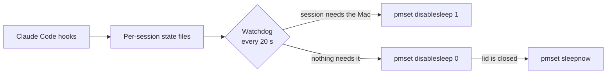

<p align="center">
  
</p>

<p align="center">
  
  
  
</p>

<p align="center">
  <b>Keep your Mac awake while Claude Code is working, even with the lid closed.<br>When the work is done, it goes back to sleep on its own.</b>
</p>

---

## Why

macOS sleeps when you close the lid. That stops a long Claude Code task halfway through, and keep-awake apps and settings that stop idle sleep don't help, because lid-close sleep is a separate thing.

The usual workaround is to turn sleep off and remember to turn it back on. Forget, and your Mac cooks in your bag.

`claude-lid-awake` does that switching for you, based on what your sessions are actually doing. It works with the `claude` CLI and the Code tab in the Claude desktop app.

## What it does

| Your session is… | Your Mac… |
|---|---|
| **Working** | Stays awake, lid open or closed |
| **Waiting on you** for an approval or an answer | Stays awake for 10 minutes |
| **Finished** | Stays awake for 5 minutes, so you can send a follow-up |
| **Idle after that** | Sleeps, straight away if the lid is closed |

### Built-in limits

- **Battery:** lets the Mac sleep at 10% or lower. There's no limit on AC power.
- **4-hour limit:** a task gets 4 hours per lid closure. Open and reclose the lid to start the timer again. Time with the lid open never counts.
- **Handoff note:** a task that hits the limit is told to stop and write down its goal, progress and exact next step, so you can resume it cleanly. The note is saved to `~/.claude/lid-awake/handoffs/`.
- **External display:** if a display is keeping your Mac on with the lid closed, it's never put to sleep behind your back.

## Install

You'll need macOS and the Xcode Command Line Tools (`xcode-select --install`).

```bash
git clone https://github.com/AdilBajwa/claude-lid-awake.git
cd claude-lid-awake
bash install.sh
```

The installer asks for your password once. Afterwards, restart any open Claude sessions so they load the hooks.

<details>
<summary><b>What the installer changes</b></summary>

<br>

| Where | What |
|---|---|
| `~/.claude/settings.json` | Adds the hooks, and saves a backup first |
| `/etc/sudoers.d/claude-lid-awake` | Allows `pmset -a disablesleep 0` and `1` without a password, and nothing else |
| `~/.claude/lid-awake/` | The script, menu bar app, logs and history |
| `~/Library/LaunchAgents/` | The menu bar app and a failsafe that runs every 5 minutes |

</details>

## Menu bar

| Icon | Meaning |
|---|---|
| ☕ | Holding the Mac awake while a session works |
| ⏳ | Waiting on you, or finished and about to sleep |
| 🌙 | Not holding, so the Mac sleeps normally |

When you open the lid, the icon shows `closed 2h 14m` for 5 minutes. The menu has:

- session counts, battery and time used against the limit
- **Lid history**, a tree you can browse by day, then closure, then task
- the last lid-closed task, with its handoff note and a one-click resume
- **Let Mac sleep now**, which stays in effect until your next prompt

## How it works



Each session gets its own state file, so parallel tool calls can't corrupt shared state. The watchdog only runs while there's something to watch.

## Safety

- It only undoes a sleep setting it set itself. If you turned "never sleep" on yourself, it's left alone.
- A crash, reboot or killed process can't leave your Mac unable to sleep, because a login failsafe checks every 5 minutes.
- The only root command it can run is `pmset -a disablesleep 0|1`.
- Hooks return in about 100 ms and stay silent, so they don't slow Claude down.

> [!WARNING]
> A Mac held awake with the lid closed has less airflow. It's fine on a desk, but avoid long runs inside a bag.

## Uninstall

```bash
bash uninstall.sh
```

This restores normal sleep and removes the hooks, sudo rule and login items. Your handoff notes and history stay in `~/.claude/lid-awake/`.

## Development

The tests fake the lid, battery and `pmset`, so they never touch your real sleep setting.

```bash
bash tests/dry-run.sh
```

## Status

This is an early release that has only been run on one Apple Silicon MacBook. Intel Macs are untested. Going to sleep automatically after a hold ends is covered by the dry-run tests but hasn't been confirmed on real hardware yet.

## License

[MIT](LICENSE). This is an independent project, not affiliated with or endorsed by Anthropic.
